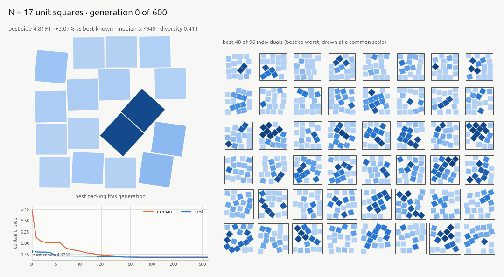
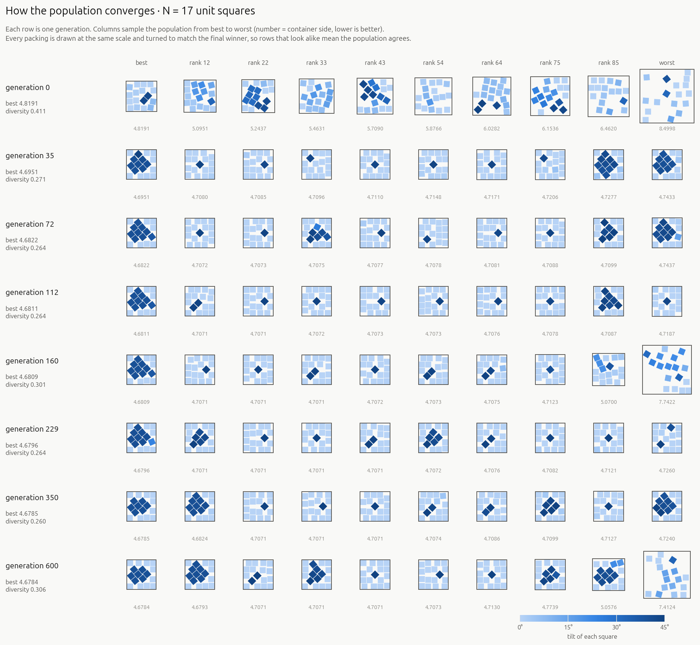

# Evolutionary square packing

Pack **N unit squares** into the **smallest possible square**, with squares free to
rotate, using a memetic genetic algorithm. Then **watch the evolution** through
static figures, animated GIFs and an interactive HTML report.



This is the classic *squares in squares* problem; best known values come from
[Erich Friedman's Packing Center](https://kingbird.myphotos.cc/packing/squares_in_squares.html),
now maintained by David Ellsworth. Sometimes the plain grid is optimal: 9 squares
fit in a 3×3 box. But often tilting a few squares wins. Five squares fit in a box of
side 2 + √2/2 ≈ 2.7071 by turning the middle one 45°. Ten fit in 3 + √2/2 ≈ 3.7071.
Many best-known packings have odd, irregular tilts that nobody has proven optimal.

## Quick start

```bash
# one-time setup: a project-local virtual environment (Python >= 3.10)
uv venv .venv --python 3.10
uv pip install --python .venv/bin/python -e ".[dev]"
# (without uv: python3 -m venv .venv && .venv/bin/pip install -e ".[dev]")

# evolve a packing of 10 squares and render every visual
.venv/bin/sqpack run 10

# then open runs/n10_seed0/figures/report.html in a browser
```

The first run spends ~20 s compiling the Numba kernels, which are cached
afterwards. With the defaults (96 individuals on 4 islands, 600 generations), a run
takes about 15 s for N = 10 and about 50 s for N ≈ 30, plus ~20 s to render the
visuals. Add `--target-gap 1e-5` to stop as soon as the best known value is matched,
or `-g 200` for a quicker look.

```text
[sqpack] n=10 pop=96 islands=4 offspring=96 generations=600 seed=0
gen    0 | best 3.83787 (record 3.7071, gap +3.53%) | median 4.1322
gen  100 | best 3.70711 (record 3.7071, gap +0.00%) | median 3.7103 | diversity 0.125 | 0.03s/gen
...
gen  600 | best 3.70711 (record 3.7071, gap +0.00%) | median 3.7090 | diversity 0.128 | 0.02s/gen
final  | side 3.707107 (record 3.7071, gap +0.00%) | valid | stop: generations | 15.7s
```

## What happens under the hood

**Genome.** An individual is a list of `(x, y, θ)` values, one per square: its centre
and its rotation. Squares are identical, so the order of the list means nothing.

**Development (Lamarckian local search).** Before a genome is scored, it is turned into
a *valid* packing:

1. **Relax.** The squares are treated as soft bodies in a square container. The overlap
   energy (squared penetration depth from the separating-axis test, plus a wall term)
   is minimised with FIRE, a damped-dynamics minimiser. FIRE moves *and rotates*
   squares using analytic gradients.
2. **Repair.** Whatever overlap is left is removed exactly by scaling all square
   centres apart by the smallest factor that separates every pair. That factor has a
   closed form for unit squares. So **every scored individual is a valid packing.**
3. **Compress.** The packing tries a slightly smaller container (squeeze → relax →
   repair) a few times and keeps any real improvement. The squeeze step `eps` grows
   on success and shrinks on failure. It is inherited by children, so the search
   step size adapts itself.

The improved packing is written back into the genome.

**Fitness** is the side of the smallest axis-aligned square containing the packing.
Lower is better. It is compared with the area bound √N, the grid packing ⌈√N⌉ and
the best known value.

**Variation.**

| Operator | What it does |
|---|---|
| tournament selection | pick parents (best of 3 random individuals) |
| geometric cut crossover | turn/mirror parent B to match parent A, cut both with a random line, keep A's squares on one side and B's on the other, fix the count along the seam |
| `jitter` | small Gaussian nudge to every square's position and angle |
| `reinsert` | pick up 1–2 squares and drop each into the emptiest of 96 sampled spots |
| `rotate` | re-orient one square to 0°, 45°, or a random angle |
| `cluster-turn` | rigidly rotate the squares near a random pivot by up to ±45° |
| `row-shift` | slide one row or column sideways by up to half a unit |

**Survival.** Parents and children compete together ((μ+λ) selection). Before a
candidate is kept, its *raster fingerprint* is compared with those already kept,
under all 8 symmetries of the square. Near-duplicates are cleared, so the population
cannot collapse onto copies of a single packing. The same fingerprint gives the
**diversity** curve in the figures.

**Islands.** The population is split into 4 sub-populations ("islands") that
evolve separately. Every 25 generations each island passes its best packing
around a ring to the next one. An island that has not improved by 0.01% in 60
generations has its worse half replaced with fresh random packings. Together with
the clearing radius, this keeps several different structures alive at once, which
is what lets the search climb out of traps such as the 4 + √2/2 packing for N = 17
(see *Results*).

**Finish.** The best packing gets a long polishing compression. It is then checked
by an independent validator (plain NumPy polygon SAT, not the optimiser's own
kernels) and saved.

## The visuals

`sqpack run` writes everything to `runs/n<N>_seed<S>/figures/`. The links show
the output of one run for N = 17 (seed 2), the run behind the animation at the top.

| File | What it shows |
|---|---|
| [`01_population_grid.png`](docs/example-n17/01_population_grid.png) | **Generations × population.** Each row is a generation, and columns sample individuals from best to worst. Every packing is drawn at one scale and turned to match the winner, so you can watch chaos turn into agreement. |
| [`02_fitness.png`](docs/example-n17/02_fitness.png) | Best, median and worst container side per generation, with the best known value and bounds, plus population diversity. |
| [`03_best_progression.png`](docs/example-n17/03_best_progression.png) | The best packing each time it improved. |
| [`04_consensus.png`](docs/example-n17/04_consensus.png) | Population-average coverage. A blur means disagreement; a crisp image means convergence. |
| [`05_tilts.png`](docs/example-n17/05_tilts.png) | Which tilt angles survive over time. |
| [`06_operators.png`](docs/example-n17/06_operators.png) | Which operators produced the surviving children, and each operator's survival rate. |
| [`07_lineage.png`](docs/example-n17/07_lineage.png) | The winner's ancestry, traced back to a random start through the operators that shaped it. |
| [`08_final_packing.png`](docs/example-n17/08_final_packing.png) | The final packing in container coordinates, with its validation summary. |
| [`09_islands.png`](docs/example-n17/09_islands.png) | Each island's best side over time. Step drops show migrants arriving, and ticks mark restarts. |
| [`evolution.gif`](docs/example-n17/evolution.gif) | Animated dashboard: best packing, the whole population and the fitness curve. |
| [`best.gif`](docs/example-n17/best.gif) | Small animation of the best packing only. |
| `report.html` | **Interactive report** (self-contained, works offline; GitHub cannot render it, so generate one locally). Scrub or play through generations, click any individual to inspect it (side, birth generation, the operator that made it), hover the charts, and browse the ancestry. Supports light and dark themes. |

`scripts/make_examples.sh` regenerates the example files in `docs/example-n17/`.

## Command line

```bash
sqpack run N [options]       # evolve, save the history, render the visuals
sqpack viz RUN_DIR           # re-render the visuals of a saved run
sqpack bench N [N ...]       # several N × seeds, no visuals, markdown summary
sqpack records [N ...]       # table of best known sides
```

Useful `run` / `bench` options (see `sqpack run -h` for all of them):

| Option | Default | Meaning |
|---|---|---|
| `--pop` | 96 | population size |
| `--generations`, `-g` | 600 | maximum generations |
| `--seed` | 0 | random seed (runs are reproducible) |
| `--islands`, `--migrate-every`, `--restart-after` | 4, 25, 60 | island model (`--islands 1` = one population) |
| `--clearing` | 0.06 | near-duplicate radius (share of raster cells that must differ) |
| `--tiebreak` | 0 | experimental: squeeze-resistance tie-break weight (no measurable benefit so far) |
| `--crossover`, `--mutation` | 0.5, 0.8 | variation probabilities |
| `--weights` | `jitter=2,reinsert=3,rotate=1.5,cluster-turn=1.5,row-shift=1` | relative mutation weights; any you leave out keep their default |
| `--relax-steps`, `--attempts` | 300, 3 | local search effort per child |
| `--patience`, `--target-gap`, `--time-limit` | – | early stopping |
| `--init` | random | `random` or `lattice` starting population |
| `--no-gif`, `--no-html`, `--no-viz`, `--frames` | – | visual output control |

Each run directory also contains `history.npz` (everything recorded per generation),
`run.json` (config and final result) and `best.json` (the packing in container
coordinates).

## Results

Default settings, 3 seeds per N (`sqpack bench ... --seeds 3`), on a 20-thread
desktop CPU. *Gap* compares the best of the three seeds with the best known side.
*Hits* counts seeds that came within 0.01%. Every reported packing passed the
independent validator.

| N | best known | best found | median of seeds | gap | hits | time / run |
|---|---|---|---|---|---|---|
| 5 | 2.7071 (2 + √2/2) | 2.7071 | 2.7071 | 0.000% | 3/3 | 21 s |
| 10 | 3.7071 (3 + √2/2) | 3.7071 | 3.7071 | 0.000% | 3/3 | 17 s |
| 11 | 3.8771 | 3.8772 | 3.8775 | +0.002% | 1/3 | 22 s |
| 13 | 4 | 4.0000 | 4.0000 | 0.000% | 3/3 | 21 s |
| 17 | 4.6755 | 4.6784 | 4.7071 | +0.062% | 0/3 | 28 s |
| 18 | 4.8229 (7/2 + √7/2) | 4.8229 | 4.8229 | 0.000% | 3/3 | 30 s |
| 19 | 4.8856 | 5.0000 | 5.0000 | +2.34% | 0/3 | 34 s |
| 26 | 5.6213 | 5.7071 | 5.7071 | +1.53% | 0/3 | 46 s |
| 27 | 5.7071 (5 + √2/2) | 5.7074 | 5.8229 | +0.005% | 1/3 | 51 s |
| 28 | 5.8244 | 5.9189 | 6.0000 | +1.62% | 0/3 | 52 s |
| 29 | 5.9338 | 6.0000 | 6.0000 | +1.12% | 0/3 | 51 s |

In a separate check with the original, cheaper settings (one population of 48,
300 generations), every N whose best known packing is the plain grid (2–4, 6–9,
12–16, 20–25) was matched on every seed.

**What the tuning showed.** The first version used a single population with a
tiny clearing radius (0.012). On every hard N it converged within ~30 generations
onto a single structure and spent the rest of the run polishing it. N = 11 always
ended at 3.8868 (+0.25%) and N = 17 at 4 + √2/2 (+0.68%). At the same budget as
today's defaults (96 individuals, 600 generations), that setup gave the same
numbers on all seeds, and adding the squeeze-resistance tie-break changed nothing.
What worked was keeping *different structures* alive. Four islands with restarts,
plus a clearing radius of 0.06, took N = 11 to +0.002% and N = 17 to +0.06% at the
same budget. With the final defaults, N = 27 also reached +0.005% (the original
smaller configuration got +2.4%), and N = 18 hit its record on 3/3 seeds instead
of 1/3. The N = 17 example below shows the mechanism: the population keeps two
families of packings side by side until the tilted-block family wins.



The remaining failures (N = 19, 26, 28, 29) have best known packings that need
several squares to tilt *together* into a structure much worse than the grid until
it is complete. Single mutations plus local relaxation rarely cross that valley.

Runs are deterministic for a given seed on a given machine, so
`sqpack bench 5 10 11 13 17 18 19 26 27 28 29 --seeds 3` reproduces the table
(timings will differ); add `--json results.json` to keep per-run results.

## Project layout

```text
src/sqpack/
  geometry.py     Numba kernels: SAT overlap, energy + analytic gradient, exact repair
  relax.py        FIRE relaxation, compression, parallel development of a batch
  operators.py    selection, geometric crossover, mutations (Numba)
  diversity.py    symmetry-aware raster fingerprints, clearing, diversity
  ga.py           the memetic GA loop (islands, migration, restarts)
  history.py      recording/saving runs and reading them back
  records.py      best known values for N <= 55
  validate.py     independent validator
  cli.py          the `sqpack` command
  viz/            static.py (PNGs), animate.py (GIFs), report.py + template (HTML)
tests/            pytest suite (`.venv/bin/python -m pytest`)
```

## Limitations

- Fitness uses an axis-aligned container. The whole packing never rotates as a
  rigid body; it re-orients square by square.
- Hard cases whose records need a coordinated group of tilted squares (N = 19, 26,
  28, 29, ...) are not reached with the default budget. See *Results*.
- `records.py` lists best known values only up to N = 55. Beyond that, the figures
  show the area bound and the grid packing.

## License

MIT. See [LICENSE](LICENSE).
